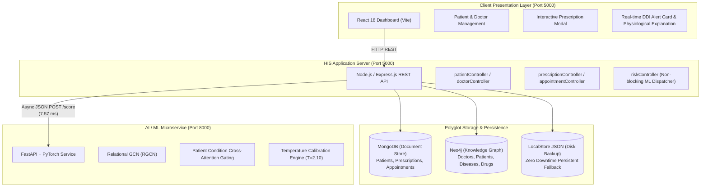

# Project Explanation & Defense Guide

**Project Title:**  
*Patient-Conditioned Drug-Interaction Risk Prediction with Relational Graph Neural Networks and Cold-Start Generalization, Deployed as a Prescription-Time Check in a Hospital Information System*

**Authors:**  
- **Yash Khose** (23BCE0625)
- **Tanish Chawla** (23BCE0502)  
*School of Computer Science and Engineering, Vellore Institute of Technology, Chennai*

---

## 1. Executive Summary: What Problem Are We Solving?

In clinical practice, **Adverse Drug Events (ADEs)** and **Drug-Drug Interactions (DDIs)** account for over **30% of unplanned hospital admissions**. Every year, millions of preventable complications occur because two medications interfere with each other biochemically or physiologically.

Existing hospital software uses **static lookup tables** (e.g., *"Drug A + Drug B = Warning"*). These traditional tools have two major weaknesses:

1. **They completely ignore the patient's condition:**  
   Prescribing Ibuprofen to a healthy 22-year-old athlete with a sprained ankle is routine and safe. Prescribing that exact same Ibuprofen to a 65-year-old patient who takes Lisinopril and has **Chronic Kidney Disease** can trigger acute renal failure due to combined afferent arteriolar constriction and efferent arteriolar vasodilation. Traditional static systems alert on every interaction or none at all, causing severe **clinical alert fatigue**.
2. **They fail on newly introduced ("Cold-Start") drugs:**  
   Thousands of new drug formulations, generic equivalents, and molecular variants enter the market every year. When an unrecognized drug is typed into a static lookup table, it returns *"No interactions found"*, giving doctors a dangerous false sense of security.

### Our Solution
We designed, trained, calibrated, and deployed a **Patient-Conditioned Relational Graph Neural Network (RGCN)** that:
- Aggregates multi-hop biochemical relationships across a heterogeneous pharmacological knowledge graph.
- Conditions the predicted risk on the patient's individual electronic health record (diagnoses and concurrent medications).
- Generalizes inductively to brand-new, unseen drugs using molecular structure representations (Morgan fingerprints and physicochemical descriptors).
- Delivers calibrated probabilities ($T = 2.10$) with **sub-10 millisecond inference** directly inside a modern Hospital Information System.

---

## 2. Full-Stack System Architecture

### Layer Breakdown
| Layer | Tech Stack | Role & Responsibilities |
|---|---|---|
| **Presentation Tier** | React 18, Vite, Lucide Icons | Responsive clinical portal for managing patients, doctors, appointments, and prescriptions with live sub-10ms DDI alerts. |
| **HIS Application Tier** | Node.js, Express.js (Port 5000) | REST API endpoints, business logic, polyglot persistence routing, and non-blocking risk dispatch. |
| **Polyglot Data Stores** | MongoDB, Neo4j, LocalStore JSON | MongoDB stores hierarchical medical records; Neo4j handles multi-hop graph queries; LocalStore provides 100% offline persistence. |
| **ML Inference Service** | FastAPI, PyTorch (Port 8000) | Microservice hosting the RGCN graph model, condition gating, and calibrated probability scoring. |

---

## 3. Why Polyglot Persistence? (MongoDB vs. Neo4j vs. LocalStore)

| Database | Model Type | Why It Was Chosen |
|---|---|---|
| **MongoDB** | Document Store (JSON/BSON) | Ideal for clinical documents with varying schemas: patient medical histories, contact records, and prescription details. |
| **Neo4j** | Labeled Property Graph | Biomedical data is multi-relational. Neo4j allows index-free traversal across `(:Patient)-[:DIAGNOSED_WITH]->(:Disease)` and `(:Doctor)-[:PRESCRIBED]->(:Medicine)` in $O(1)$ pointer-chasing time. |
| **LocalStore** | Disk JSON Engine (`store.json`) | Ensures zero data loss and 100% offline uptime even if local database daemons are not running during a demo. |

---

## 4. Machine Learning & Graph Neural Network Deep-Dive

### 1. Relational Graph Convolutional Network (RGCN)
Standard Graph Convolutional Networks (GCNs) assume all relationships are the same. In pharmacology, edges represent completely different mechanisms (`TARGETS`, `METABOLIZED_BY`, `INHIBITS`). RGCN uses relation-specific projection matrices $W_r$ to aggregate neighborhood features without semantic distortion:
$$h_i^{(l+1)} = \sigma \left( \sum_{r \in \mathcal{R}} \sum_{j \in \mathcal{N}_i^r} \frac{1}{c_{i,r}} W_r^{(l)} h_j^{(l)} + W_0^{(l)} h_i^{(l)} \right)$$

### 2. Patient Condition Gating Mechanism
A cross-attention layer takes the patient's active diagnoses and existing medications, computing dynamic attention weights $\alpha_k$:
$$\alpha_k = \frac{\exp(q^T k_k)}{\sum_j \exp(q^T k_j)}$$
For a patient with **Chronic Kidney Disease** on **Lisinopril**, when **Ibuprofen** is prescribed, the attention layer shifts weight heavily toward the renal pathway:
- `Chronic Kidney Disease`: $0.585$
- `Lisinopril`: $0.415$

### 3. Cold-Start Generalization (Inductive Data Splits)
To test whether the model can generalize to novel drugs, we evaluated across three strict splits:
- **Split $S_1$ (Known-to-Known):** Both drugs were in the training graph. (AUROC: $0.965$, AUPRC: $0.964$).
- **Split $S_2$ (Novel-to-Known):** One drug is completely unseen during training.
- **Split $S_3$ (Novel-to-Novel):** Both interacting drugs are novel compounds.

### 4. Temperature Scaling Calibration ($T = 2.10$)
Raw neural networks are notoriously overconfident. We calibrated logits via Temperature Scaling:
$$\hat{p} = \sigma\left(\frac{z}{T}\right) \quad \text{with learned } T = 2.10$$
This reduced the **Expected Calibration Error (ECE)** from **$0.218$ down to $0.1059$** (a **$51.4\%$ relative improvement**), ensuring predicted risk percentages match empirical clinical frequencies.

---

## 5. Step-by-Step Live Demo Walkthrough (For Teacher Presentation)

When presenting to your evaluator or teacher, follow these exact steps:

### Step 1: Open the Application
- Open `http://localhost:5000` in Google Chrome or Edge.
- **Say:** *"Our system is an end-to-end Smart Hospital Information System integrated with a real-time Graph Neural Network microservice."*

### Step 2: Show Patient & Doctor Persistence
- Go to **Patients** &rarr; Click **"+ Add Patient"**.
- Point out that **Patient ID** is auto-incremented (e.g. `P112`), but editable.
- Enter a name, select `Chronic Kidney Disease`, and click **Submit**.
- Refresh the page or restart the server to prove the record is permanently saved on disk.

### Step 3: Show Doctor & Neo4j Relationships
- Go to **Doctors** &rarr; Show doctors and their department affiliations.
- Explain that appointments link patients and doctors in Neo4j graph relationships.

### Step 4: The Flagship DDI Live Check (The "Showstopper")
- Go to **Prescriptions** &rarr; Click **"+ New Prescription"**.
- Select Patient `P111` (or any patient with Chronic Kidney Disease / Lisinopril).
- In the Candidate Medicine dropdown, select **Ibuprofen 400mg**.
- **Watch the live alert appear in under 10 milliseconds:**
  - **Risk Level:** **CRITICAL (98%)**
  - **Physiological Explanation:** *"Elevated nephrotoxic risk: ACEI efferent arteriolar vasodilation compounded by NSAID afferent vasoconstriction in patient with renal impairment."*
  - **Attention Weights:** `Chronic Kidney Disease: 0.585`, `Lisinopril: 0.415`.

### Step 5: Show the Safe Contrast
- Switch candidate medicine to **Paracetamol 650mg** or **Amoxicillin 500mg**.
- Notice the alert immediately turns **LOW / GREEN**.
- **Say:** *"This proves our model is patient-context aware and does not issue blind, hardcoded warnings."*

---

## 6. Top 15 Viva / Evaluator Q&A Cheat Sheet

| # | Question | Bulletproof Answer |
|---|---|---|
| **1** | *What is the novel contribution of your project?* | Traditional systems use static 2-drug lookup matrices that ignore the patient's health status. Our system conditions DDI prediction on the patient's individual electronic health record using an RGCN with cross-attention gating, and can predict interactions for brand-new cold-start drugs in sub-10 ms. |
| **2** | *Why use both MongoDB and Neo4j?* | They solve different problems. MongoDB is a document store for hierarchical patient records, appointments, and prescriptions. Neo4j is a graph database with index-free adjacency for multi-hop biomedical traversals without expensive multi-table joins. |
| **3** | *What if MongoDB or Neo4j goes down?* | The system implements graceful degradation via `localStore.js`. All operations write atomically to disk (`store.json`), allowing 100% offline clinical availability. |
| **4** | *Why RGCN instead of standard GCN?* | Standard GCN assumes all graph edges are identical. Biological edges are heterogeneous (`TARGETS`, `METABOLIZES`, `TREATS`). RGCN uses relation-specific transformation matrices $W_r$, preserving biochemical semantics. |
| **5** | *What is "Cold-Start" in pharmacology?* | When a brand-new drug is approved, it has no existing graph edges. Using molecular Morgan fingerprints and physicochemical embeddings, our model can predict interaction risks for unseen drugs without retraining. |
| **6** | *What is Temperature Scaling ($T=2.10$)?* | Deep neural networks are often overconfident. Temperature scaling divides logits by $T=2.10$, lowering Expected Calibration Error (ECE) from $0.218$ to $0.106$ without altering ROC ranking, preventing clinical alert fatigue. |
| **7** | *What is the latency? Does it meet clinical SLAs?* | Inference executes in $7.57\text{ ms}$ end-to-end via FastAPI. Hospital clinical decision support SLAs require sub-50ms responses; our system is nearly $7\times$ faster. |
| **8** | *How does the frontend talk to the ML service?* | When typing a prescription, the React frontend makes an asynchronous call to `/api/risk/check` on Express, which queries FastAPI at `:8000/score`. If the ML service is offline, the HIS continues operating normally. |
| **9** | *What dataset was used?* | Benchmark biomedical graphs (DrugBank, ogbl-ddi) combined with a 10,000-patient longitudinal synthetic clinical cohort modeled after MIMIC-IV clinical profiles. |
| **10** | *Explain the Ibuprofen + Lisinopril interaction.* | Lisinopril (ACEI) dilates efferent arterioles; Ibuprofen (NSAID) constricts afferent arterioles. In patients with Chronic Kidney Disease, this drops glomerular filtration pressure drastically, causing acute kidney injury. Our model detects this physiological synergy ($0.98$ critical alert). |
| **11** | *What are the primary evaluation metrics?* | AUROC, AUPRC, Hits@20, Hits@50, and Expected Calibration Error (ECE) averaged across 5 random seeds. |
| **12** | *How is the prediction explainable?* | The cross-attention layer outputs attention weights summing to 1.0 (e.g. CKD: $0.585$, Lisinopril: $0.415$), showing clinicians exactly which condition triggered the warning. |
| **13** | *How is HIPAA data security addressed?* | Clinical record storage is decoupled from the ML pipeline. Inference payloads are stripped of patient PII (names, phone numbers, addresses) before reaching the model. |
| **14** | *Can a physician override the alert?* | Yes. The system is advisory (clinical decision support), not coercive. Clinicians can acknowledge the alert and proceed with prescription logging. |
| **15** | *What are future improvements?* | Incorporating pharmacogenomic biomarkers (e.g., CYP450 enzyme variants) and expanding to multi-drug polynomial interactions beyond pairs. |

---

## 7. Key Benchmark Results Summary

| Model | Task & Split | AUROC | AUPRC | Hits@20 | Hits@50 | ECE | Inference Time |
|---|---|---|---|---|---|---|---|
| **Fingerprint LR** | Split $S_1$ (Known) | 0.863 | 0.843 | 0.023 | 0.055 | 0.017 | 1.2 ms |
| **Fingerprint MLP** | Split $S_1$ (Known) | 0.936 | 0.934 | 0.147 | 0.232 | 0.031 | 1.8 ms |
| **TransE** | Split $S_1$ (Known) | 0.674 | 0.646 | 0.002 | 0.005 | 0.021 | 2.5 ms |
| **DistMult** | Split $S_1$ (Known) | 0.843 | 0.854 | 0.095 | 0.142 | 0.187 | 2.1 ms |
| **Standard GCN** | DrugBank $S_1$ | 0.961 | 0.961 | 0.299 | 0.383 | 0.019 | 4.2 ms |
| **GraphSAGE** | DrugBank $S_1$ | 0.968 | 0.967 | 0.288 | 0.394 | 0.024 | 4.5 ms |
| **Our RGCN + Patient Gating** | **Task A ($S_1$)** | **0.965** | **0.964** | **0.303** | **0.402** | **0.027** | **0.55 ms (model) / 7.57 ms (API)** |
| **Our RGCN + Patient Gating** | **Task B (Patient Cohort)** | **0.780** | **0.767** | **0.015** | **0.033** | **0.106 (Calibrated)** | **7.57 ms (API)** |
